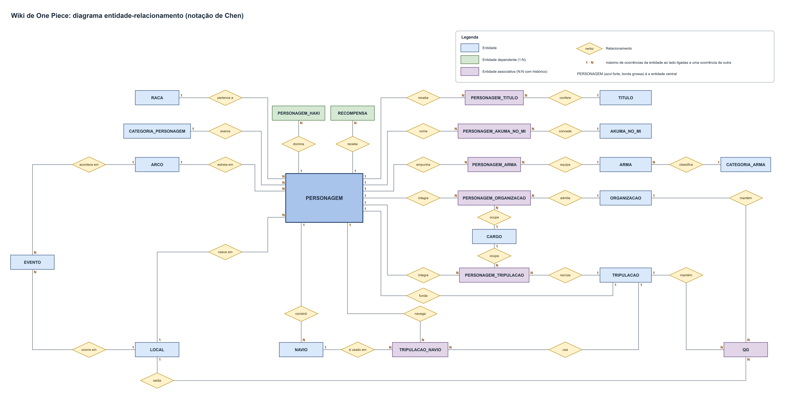
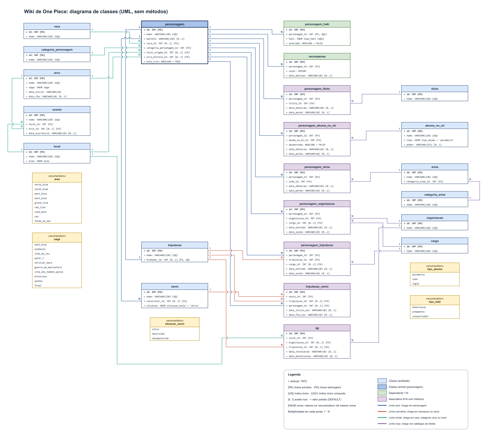

# Wiki de One Piece em MySQL

Banco de dados relacional que cataloga e historiza o universo de **One Piece**: personagens, raças, tripulações, organizações, títulos, Akuma no Mi, Haki, armas, navios, quartéis-generais, locais, arcos, eventos e recompensas. Cada vínculo guarda o período em que valeu, com datas no calendário oficial da obra (Kaienreki).

Projeto Final da disciplina **Banco de Dados**, curso de **Engenharia da Computação**, Afya Centro Universitário, semestre 2/2026.

## Integrantes

- Thiago Souza Lima e Lima
- Wanderson Rodrigues da Silva

## Tecnologia

- SQL puro em **MySQL 8.0.19 ou superior** (desenvolvido e testado no MySQL Community Server 8.0.46)
- MySQL Workbench 8.0 para execução e demonstração
- draw.io Desktop para os diagramas
- API MediaWiki da One Piece Wiki e Python 3.12 apenas na coleta e conversão dos dados de povoamento (o banco e as consultas são SQL puro)
- Git e GitHub para versionamento

## Estrutura do repositório

```
├── README.md
├── docs/
│   ├── relatorio.md            relatório técnico
│   ├── dicionario-dados.md     dicionário de dados
│   └── diagrama/
│       ├── der.drawio          diagrama entidade-relacionamento (editável no draw.io)
│       ├── der.png
│       ├── diagrama-classes.drawio   diagrama de classes (editável no draw.io)
│       └── diagrama-classes.png
└── sql/
    ├── 01-banco-e-dados.sql    criação do banco e das tabelas e povoamento
    └── 02-consultas.sql        consultas comentadas
```

## Como executar

> O script `01-banco-e-dados.sql` cria o banco `onepiece_wiki`. Se ele já existir na instância, o script para logo na primeira linha; para executá-lo de novo, apague o banco antes.

**MySQL Workbench:** abra `sql/01-banco-e-dados.sql` em *File › Open SQL Script* e execute o script inteiro. Depois faça o mesmo com `sql/02-consultas.sql`.

**Linha de comando:**

```bash
mysql -u <usuario> -p --default-character-set=utf8mb4 < sql/01-banco-e-dados.sql
mysql -u <usuario> -p --default-character-set=utf8mb4 onepiece_wiki < sql/02-consultas.sql
```

## Visão geral do modelo

**Diagrama entidade-relacionamento (notação de Chen)**



**Diagrama de classes (UML)**



- 23 tabelas em Terceira Forma Normal, com relacionamentos 1:1, 1:N e N:N
- 29 chaves estrangeiras, todas com `ON UPDATE` e `ON DELETE` explícitos
- 16 índices únicos, 29 restrições `CHECK` e 5 valores `DEFAULT`

Detalhes em [`docs/relatorio.md`](docs/relatorio.md) e [`docs/dicionario-dados.md`](docs/dicionario-dados.md).

## Dados

O povoamento tem 4.641 registros, com pelo menos 15 em cada tabela, coletados da [One Piece Wiki](https://onepiece.fandom.com/) e da linha do tempo da [Library of Ohara](https://thelibraryofohara.com/the-one-piece-timeline/). Entra só o conteúdo canônico até o episódio 1180 do anime, e as datas estão no calendário Kaienreki.

## Situação

| Entrega | Situação |
|---|---|
| Estrutura do banco (tabelas e restrições) | concluída |
| Diagramas (entidade-relacionamento e classes), dicionário de dados e relatório | concluídos |
| Povoamento (15+ registros por tabela) | concluído |
| Consultas (`sql/02-consultas.sql`) | concluídas: 5 simples e 5 com JOIN |
