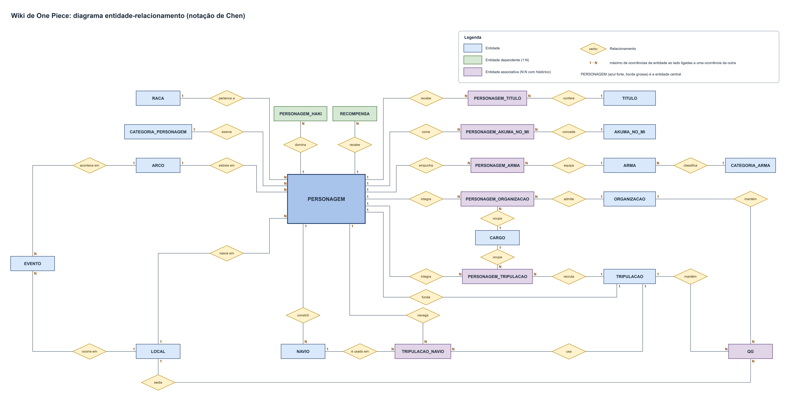
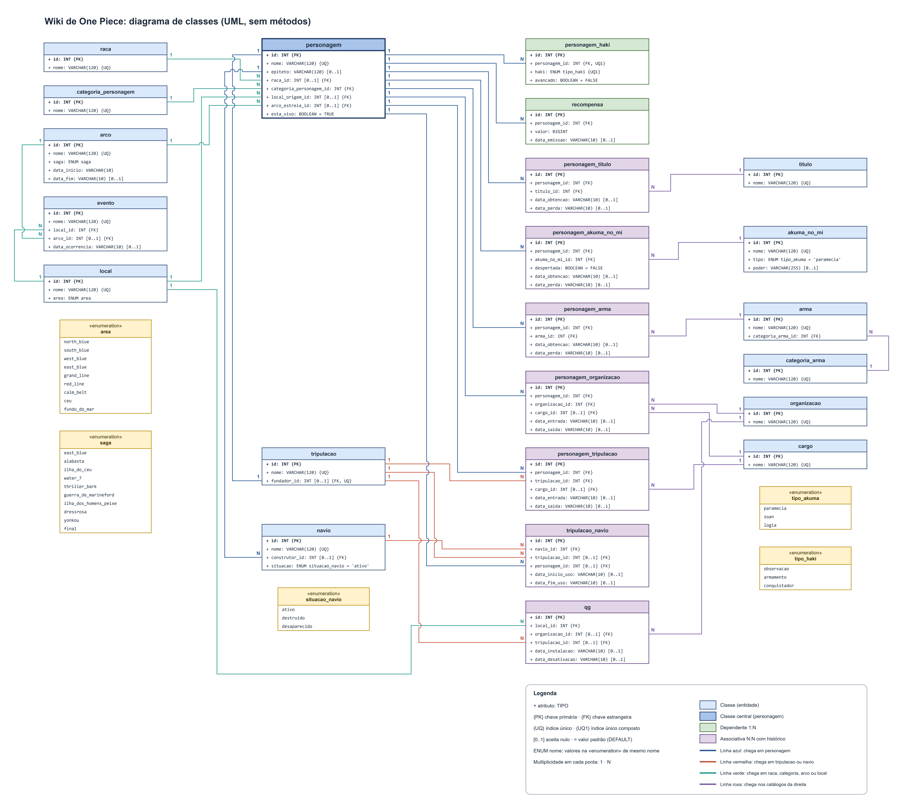

# Wiki de One Piece: banco de dados relacional em MySQL

## 1. Capa e identificação

| Item | Informação |
|---|---|
| Título | Wiki de One Piece: modelagem, implementação e análise de um banco de dados relacional em MySQL |
| Integrantes | Thiago Souza Lima e Lima · Wanderson Rodrigues da Silva |
| Disciplina | Banco de Dados |
| Curso | Engenharia da Computação |
| Instituição | Afya Centro Universitário |
| Semestre | 1/2026 |

## 2. Resumo executivo

One Piece é uma obra japonesa com quase 30 anos de publicação, contada em mangá, anime, live action e outras mídias, que acompanha Monkey D. Luffy em busca do sonho de se tornar o Rei dos Piratas. O universo da obra reúne centenas de personagens, tripulações, organizações, ilhas, navios, frutas do diabo e acontecimentos que se cruzam ao longo de décadas da história interna.

Este projeto modela esse universo em um banco relacional MySQL, o `onepiece_wiki`, capaz de catalogar e historizar a trajetória da obra: quem pertenceu a qual tripulação ou organização e em que período, quem comeu cada Akuma no Mi, por quais navios uma tripulação passou, como as recompensas evoluíram e em que arco cada fato acontece. O esquema tem 23 tabelas em Terceira Forma Normal, com relacionamentos 1:1, 1:N e N:N, e datas registradas no calendário oficial da obra.

## 3. Domínio e regras de negócio

O domínio é uma enciclopédia (wiki) do mundo de One Piece. A entidade central é o **personagem**, que tem uma ocupação principal e pode ter uma raça, um local de origem e um arco de estreia, quando a fonte os informa. Em volta dele ficam os vínculos que mudam com o tempo: títulos, organizações, tripulações, frutas, armas, navios e recompensas. O mundo é organizado em **locais** dentro de áreas (os quatro Blues, a Grand Line, a Red Line, o Calm Belt, as ilhas do céu e o fundo do mar), e a história é dividida em **arcos** agrupados em sagas, onde acontecem os **eventos**.

As datas seguem o calendário interno da obra, o Kaienreki (Calendário do Mar). O presente da história é 1522 antes do salto temporal de dois anos e 1524 depois dele.

### Regras de negócio

| Código | Regra |
|---|---|
| RN01 | Todo personagem tem uma ocupação principal (categoria) e no máximo uma raça; a raça fica nula quando a fonte não a informa. Tribos, como as Kuja, não são raças. |
| RN02 | O nome do personagem é único e registrado de forma completa (ex.: Monkey D. Luffy, Monkey D. Garp). |
| RN03 | Títulos como Yonkou e Shichibukai não são ocupação: um personagem pode acumular títulos e perdê-los, por isso cada título tem data de obtenção e de perda. |
| RN04 | Um personagem pode pertencer a várias tripulações e organizações ao longo da vida, com cargo e período. Quem sai e volta ganha um novo registro. |
| RN05 | Toda tripulação tem no máximo um fundador, nulo quando a fonte não o informa, e um personagem funda no máximo uma tripulação (relacionamento 1:1). |
| RN06 | Só existe uma Akuma no Mi de cada no mundo. Uma fruta pode ter usuários diferentes em sequência (Mera Mera no Mi: Ace e depois Sabo), e um personagem pode ter mais de uma fruta (Barba Negra). O despertar é registrado por usuário. |
| RN07 | O Haki tem três tipos (observação, armamento e conquistador). Cada personagem tem no máximo um registro por tipo, e o nível avançado substitui o básico no mesmo registro. |
| RN08 | Toda arma pertence a uma categoria e pode trocar de dono (Wado Ichimonji: Kuina e depois Zoro). |
| RN09 | Um navio é usado por uma tripulação inteira ou, em casos de uso curto, por um personagem sozinho, nunca pelos dois no mesmo registro. O construtor é opcional e o navio tem uma situação (ativo, destruído ou desaparecido). |
| RN10 | Um quartel-general fica em um local e pertence a uma organização ou a uma tripulação, nunca às duas. |
| RN11 | A recompensa de um personagem muda ao longo da história; cada valor emitido é um registro, sempre maior que zero, em berries. |
| RN12 | Datas usam o calendário Kaienreki no formato `AAAA-MM-DD`. Mês ou dia desconhecido é gravado como `01`. Data final nula significa que o vínculo ainda vigora ou que o fim não é conhecido; data inicial nula significa início desconhecido. A data final nunca é anterior à inicial. |
| RN13 | Cada evento acontece em um local e, quando faz parte da história contada, em um arco. Fatos do passado, como o Incidente de God Valley, podem não ter arco. |
| RN14 | Excluir um personagem exclui o histórico dele. Cadastros base e entidades usadas no histórico de outros personagens não podem ser excluídos enquanto estiverem em uso. Origem, estreia e construtor passam a nulo se o registro referenciado for excluído. |
| RN15 | Área, saga, tipo de fruta, situação do navio e tipo de Haki são listas fixas (ENUM), porque têm menos de 15 valores na obra. |

## 4. Diagramas

O modelo é apresentado em dois diagramas, feitos no draw.io. Os arquivos editáveis (`.drawio`) estão em [`diagrama/`](diagrama/) e podem ser abertos no draw.io Desktop ou em app.diagrams.net.

### 4.1 Diagrama entidade-relacionamento



*Figura 1: diagrama entidade-relacionamento em notação de Chen, só com entidades e relacionamentos.*

**Legenda.** As cores indicam o papel de cada entidade:

| Cor | Papel | Entidades |
|---|---|---|
| Azul | Entidade | `RACA`, `CATEGORIA_PERSONAGEM`, `ARCO`, `EVENTO`, `LOCAL`, `TITULO`, `AKUMA_NO_MI`, `ARMA`, `CATEGORIA_ARMA`, `ORGANIZACAO`, `CARGO`, `TRIPULACAO`, `NAVIO` |
| Azul forte, borda grossa | Entidade central | `PERSONAGEM` |
| Verde | Entidade dependente (1:N), que só existe ligada a um personagem | `PERSONAGEM_HAKI`, `RECOMPENSA` |
| Lilás | Entidade associativa (N:N com histórico), posicionada entre as duas entidades que liga | `PERSONAGEM_TITULO`, `PERSONAGEM_AKUMA_NO_MI`, `PERSONAGEM_ARMA`, `PERSONAGEM_ORGANIZACAO`, `PERSONAGEM_TRIPULACAO`, `TRIPULACAO_NAVIO`, `QG` |

Losangos são relacionamentos, nomeados por um verbo. Nas cadeias da direita, o primeiro verbo se lê a partir do personagem ("PERSONAGEM recebe PERSONAGEM_TITULO") e o segundo a partir do catálogo ("TITULO confere PERSONAGEM_TITULO"). Cada linha traz a cardinalidade máxima (`1` ou `N`) encostada na entidade a que se refere: ela indica quantas ocorrências daquela entidade, no máximo, se ligam a uma ocorrência da entidade do outro lado. Exemplo: cada `PERSONAGEM_TRIPULACAO` se liga a um `PERSONAGEM` (1), e cada `PERSONAGEM` pode ter muitos registros em `PERSONAGEM_TRIPULACAO` (N). A única relação 1:1 é "funda", entre `PERSONAGEM` (1) e `TRIPULACAO` (1).

Organização do diagrama: `PERSONAGEM` fica no centro, e cada relacionamento chega a ele por uma linha própria, dobrada em ângulo reto, num ponto diferente da borda. À esquerda estão raça, categoria e arco, com o evento ligado a arco e local; acima, Haki e recompensas; à direita, as cadeias de histórico até título, Akuma no Mi, arma, organização e tripulação, com o cargo entre organização e tripulação; abaixo, navio e uso de navio. O local fica embaixo à esquerda e o QG embaixo à direita, ligados pelo relacionamento "sedia" ao longo da base. Nenhuma linha cruza outra.

### 4.2 Diagrama de classes



*Figura 2: diagrama de classes UML do esquema físico, com atributos e multiplicidades, sem métodos.*

**Legenda.** Cada classe é uma tabela, e cada atributo segue o formato `+ nome: TIPO`. As marcações são `{PK}` (chave primária), `{FK}` (chave estrangeira), `{UQ}` (índice único de uma coluna) e `{UQ1}` (índice único composto, o par `personagem_id` + `haki` em `personagem_haki`). `[0..1]` indica atributo que aceita nulo e `= valor` indica o valor padrão (DEFAULT). Atributos do tipo `ENUM nome` têm os valores listados na classe `«enumeration»` de mesmo nome (`area`, `saga`, `situacao_navio`, `tipo_akuma` e `tipo_haki`).

As cores das classes seguem as do diagrama entidade-relacionamento (azul: entidade; azul forte: `personagem`; verde: dependente 1:N; lilás: associativa N:N com histórico; amarelo: enumeração). As associações saem da linha da chave estrangeira, trazem a multiplicidade máxima em cada ponta (`1` ou `N`), encostada na classe, e são coloridas pela classe de destino:

| Cor da linha | Destino |
|---|---|
| Azul | `personagem` |
| Vermelho | `tripulacao` ou `navio` |
| Verde | `raca`, `categoria_personagem`, `arco` ou `local` |
| Roxo | catálogos da direita (`titulo`, `akuma_no_mi`, `arma`, `categoria_arma`, `organizacao`, `cargo`) |

Cada associação tem o próprio trajeto, do início ao fim: nenhuma linha se junta ou se sobrepõe a outra, e onde uma linha cruza outra há um salto em arco.

Organização do diagrama, da esquerda para a direita:

1. **Cadastros de contexto:** `raca`, `categoria_personagem`, `arco`, `evento` e `local`, com as enumerações `area` e `saga` abaixo.
2. **Entidades principais:** `personagem`, `tripulacao` e `navio`, cada uma na altura das tabelas que mais a referenciam.
3. **Ligações e histórico:** `personagem_haki`, `recompensa`, as tabelas `personagem_*`, `tripulacao_navio` e `qg`.
4. **Catálogos referenciados pelo histórico:** `titulo`, `akuma_no_mi`, `arma`, `categoria_arma`, `organizacao` e `cargo`, cada um alinhado à tabela de ligação correspondente, com as enumerações `tipo_akuma` e `tipo_haki` abaixo.

## 5. Dicionário de dados

O dicionário completo, com cada coluna, tipo, restrição e descrição, está em [`dicionario-dados.md`](dicionario-dados.md). Resumo das tabelas:

| Tabela | Conteúdo |
|---|---|
| `raca` | Raças do universo |
| `categoria_personagem` | Ocupação principal do personagem |
| `titulo` | Títulos e honrarias (Yonkou, Shichibukai...) |
| `organizacao` | Organizações (Marinha, Governo Mundial...) |
| `cargo` | Funções em tripulações e patentes em organizações |
| `akuma_no_mi` | Frutas do Diabo, com tipo e poder |
| `categoria_arma` | Categorias de armas |
| `local` | Ilhas, países e cidades, com a área do mundo |
| `arco` | Arcos da história, com saga e período Kaienreki |
| `evento` | Batalhas e acontecimentos, com local, arco e data |
| `personagem` | Personagens, com raça, ocupação, origem, estreia e situação de vida |
| `tripulacao` | Tripulações piratas e seu fundador |
| `arma` | Armas com nome próprio |
| `navio` | Navios, construtor e situação |
| `personagem_haki` | Tipos de Haki de cada personagem e se é avançado |
| `personagem_titulo` | Títulos de cada personagem, com período |
| `personagem_organizacao` | Participação em organizações, com cargo e período |
| `personagem_tripulacao` | Participação em tripulações, com cargo e período |
| `personagem_akuma_no_mi` | Usuários de cada fruta, com período e despertar |
| `personagem_arma` | Donos de cada arma, com período |
| `tripulacao_navio` | Uso de navios por tripulações ou personagens |
| `qg` | Quartéis-generais de organizações e tripulações |
| `recompensa` | Histórico de recompensas |

## 6. Justificativa da normalização

O esquema atende à **Terceira Forma Normal (3FN)**.

- **1FN (valores atômicos, sem grupos repetidos).** Nenhuma coluna guarda lista de valores. Tudo o que um personagem pode ter mais de uma vez (títulos, tipos de Haki, recompensas, frutas, armas, vínculos com tripulações e organizações) virou linha em tabela própria.
- **2FN (sem dependência parcial).** Toda tabela tem chave primária simples (`id`), então não há como um atributo depender só de parte da chave. Nas tabelas de ligação, os atributos pertencem ao vínculo e não a um dos lados: o cargo e as datas de entrada e saída são do vínculo entre personagem e tripulação, não do personagem nem da tripulação.
- **3FN (sem dependência transitiva).** Atributos que dependem de outra entidade foram para a tabela dela. A área de origem de um personagem não é coluna de `personagem`: ela é obtida por `personagem → local → area`. Da mesma forma, a saga de um evento vem de `evento → arco → saga`, e o nome da raça fica só em `raca`.

### Exemplo de decomposição

O esboço inicial do modelo tinha uma única relação para o personagem, com a recompensa como coluna e a categoria misturando ocupação e título:

`PERSONAGEM_INICIAL(nome, raca, categoria, recompensa, esta_vivo)`

| nome | raca | categoria | recompensa | esta_vivo |
|---|---|---|---|---|
| Monkey D. Luffy | Humano | Pirata | 30.000.000; 100.000.000; 300.000.000... | sim |
| Dracule Mihawk | Humano | Pirata; Shichibukai | ... | sim |
| Jinbe | Homem-Peixe | Pirata; Shichibukai | ... | sim |

Problemas dessa relação:

1. **Viola a 1FN:** `recompensa` e `categoria` guardam vários valores na mesma célula.
2. **Anomalia de atualização:** o nome da raça se repete em cada personagem. Corrigir a grafia de "Homem-Peixe" exigiria alterar todas as linhas.
3. **Anomalia de inserção:** não é possível cadastrar um título (ex.: "Pior Geração") antes de existir um personagem com ele.
4. **Anomalia de exclusão:** excluir o único Shichibukai cadastrado apagaria a existência do título.
5. **Perda de histórico:** quando um título é perdido (fim dos Shichibukai), sobrescrever o valor apaga o passado.

Decomposição aplicada:

| Relação resultante | Atributos |
|---|---|
| `raca` | id, nome |
| `categoria_personagem` | id, nome (só ocupação) |
| `titulo` | id, nome |
| `personagem` | id, nome, raca_id, categoria_personagem_id, esta_vivo... |
| `personagem_titulo` | id, personagem_id, titulo_id, data_obtencao, data_perda |
| `recompensa` | id, personagem_id, valor, data_emissao |

Com isso cada fato é registrado uma única vez, títulos e raças existem por conta própria e o histórico de títulos e recompensas é preservado.

## 7. Catálogo de consultas

As consultas estão em [`sql/02-consultas.sql`](../sql/02-consultas.sql) e foram executadas sobre o banco criado e povoado por `sql/01-banco-e-dados.sql`. Os exemplos de saída abaixo mostram as primeiras linhas de cada resultado.

| Consulta | Categoria | Tabelas | Recursos |
|---|---|---|---|
| Q1 | Simples | 1 | WHERE, LIKE, ORDER BY |
| Q2 | Simples | 1 | WHERE, BETWEEN, ORDER BY |
| Q3 | Simples | 1 | WHERE, IN, ORDER BY |
| Q4 | Simples | 1 | DISTINCT, WHERE, LIKE, ORDER BY |
| Q5 | Simples | 1 | ORDER BY, LIMIT |
| Q6 | JOIN | 2 | INNER JOIN, GROUP BY, COUNT |
| Q7 | JOIN | 2 | INNER JOIN, GROUP BY, HAVING, COUNT, MIN, MAX, AVG |
| Q8 | JOIN | 2 | INNER JOIN, WHERE, GROUP BY, COUNT, SUM |
| Q9 | JOIN | 4 | INNER JOIN, LEFT JOIN, WHERE, ORDER BY |
| Q10 | JOIN | 3 | INNER JOIN, WHERE, GROUP BY, COUNT |

### Q1. Personagens do Clã D.

Quem carrega a inicial "D." no nome? A consulta lista os personagens da linhagem do Clã D., em ordem alfabética, com o epíteto de cada um.

```sql
SELECT
  personagem.nome    AS nome,
  personagem.epiteto AS epiteto
FROM personagem
WHERE
  (personagem.nome LIKE '%D.%')
ORDER BY
  personagem.nome;
```

Exemplo de saída (5 de 14 linhas):

| nome | epiteto |
|---|---|
| Clou D. Clover | NULL |
| D. D. Tee | NULL |
| Davy D. Jones | Pirata do Mar Profundo |
| Gol D. Roger | Rei dos Piratas |
| Jaguar D. Saul | NULL |

### Q2. Eventos da Era de Roger

O que marcou o mundo na época de Gol D. Roger, até a execução dele em 1500? A consulta lista os eventos ocorridos entre 1480 e 1500, em ordem cronológica. Como as datas são guardadas como texto no formato `AAAA-MM-DD`, a ordem alfabética coincide com a cronológica e o `BETWEEN` funciona como um intervalo de tempo.

```sql
SELECT
  evento.nome            AS nome,
  evento.data_ocorrencia AS data_ocorrencia
FROM evento
WHERE
  (evento.data_ocorrencia BETWEEN '1480-01-01' AND '1500-12-31')
ORDER BY
  evento.data_ocorrencia;
```

Exemplo de saída (4 de 4 linhas):

| nome | data_ocorrencia |
|---|---|
| Revolta do Harém | 1480-01-01 |
| Incidente do Deus da Montanha | 1483-01-01 |
| Incidente de God Valley | 1486-01-01 |
| Batalha de Edd War | 1497-01-01 |

### Q3. Navios fora de uso

Quais navios não navegam mais? A consulta lista os navios destruídos ou desaparecidos, agrupados pela situação e em ordem alfabética.

```sql
SELECT
  navio.nome     AS nome,
  navio.situacao AS situacao
FROM navio
WHERE
  (navio.situacao IN ('destruido', 'desaparecido'))
ORDER BY
  navio.situacao,
  navio.nome;
```

Exemplo de saída (5 de 32 linhas):

| nome | situacao |
|---|---|
| Blood Batako | destruido |
| Cooking George | destruido |
| Dreadnaught Sabre | destruido |
| Going Luffy-senpai | destruido |
| Going Merry | destruido |

### Q4. Sagas depois do salto temporal

Quais sagas acontecem depois do salto temporal de dois anos? A consulta lista, sem repetição, as sagas que têm arcos iniciados em 1524. Como `saga` é um ENUM, a ordenação segue a ordem de declaração dos valores, que é a ordem cronológica das sagas.

```sql
SELECT DISTINCT
  arco.saga AS saga
FROM arco
WHERE
  (arco.data_inicio LIKE '1524-%')
ORDER BY
  arco.saga;
```

Exemplo de saída (4 de 4 linhas):

| saga |
|---|
| ilha_dos_homens_peixe |
| dressrosa |
| yonkou |
| final |

### Q5. Os 5 primeiros arcos

Como começa a jornada? A consulta lista os 5 primeiros arcos da história, pela data de início e, no empate, pela data de fim.

```sql
SELECT
  arco.nome        AS nome,
  arco.saga        AS saga,
  arco.data_inicio AS data_inicio
FROM arco
ORDER BY
  arco.data_inicio,
  arco.data_fim
LIMIT 5;
```

Exemplo de saída (5 de 5 linhas):

| nome | saga | data_inicio |
|---|---|---|
| Romance Dawn | east_blue | 1522-02-01 |
| Orange Town | east_blue | 1522-02-01 |
| Vila Syrup | east_blue | 1522-02-11 |
| Baratie | east_blue | 1522-02-14 |
| Arlong Park | east_blue | 1522-02-15 |

### Q6. Personagens por raça

Quais raças são mais frequentes no universo da obra? A consulta conta os personagens de cada raça, da mais numerosa para a menos numerosa. Personagens sem raça informada ficam de fora, porque o `INNER JOIN` exige correspondência em `raca`.

```sql
SELECT
  raca.nome AS raca,
  COUNT(*)  AS quantidade_personagens
FROM personagem INNER JOIN raca ON (raca.id = personagem.raca_id)
GROUP BY
  raca.nome
ORDER BY
  quantidade_personagens DESC;
```

Exemplo de saída (6 de 24 linhas):

| raca | quantidade_personagens |
|---|---|
| Humano | 958 |
| Animal | 50 |
| Gigante | 48 |
| Homem-Peixe | 40 |
| Povo-Sereia | 29 |
| Mink | 23 |

### Q7. Evolução das recompensas

Como as recompensas evoluíram para quem foi procurado várias vezes? Para cada personagem com 3 ou mais recompensas emitidas, a consulta mostra a quantidade, a menor, a maior e a média dos valores. O `HAVING` filtra os grupos depois do `GROUP BY`, mantendo só os personagens com pelo menos 3 recompensas.

```sql
SELECT
  personagem.nome                 AS personagem,
  COUNT(*)                        AS quantidade_recompensas,
  MIN(recompensa.valor)           AS menor_recompensa,
  MAX(recompensa.valor)           AS maior_recompensa,
  ROUND(AVG(recompensa.valor), 2) AS media_recompensa
FROM recompensa INNER JOIN personagem ON (personagem.id = recompensa.personagem_id)
GROUP BY
  personagem.nome
HAVING
  (COUNT(*) >= 3)
ORDER BY
  maior_recompensa DESC;
```

Exemplo de saída (5 de 13 linhas):

| personagem | quantidade_recompensas | menor_recompensa | maior_recompensa | media_recompensa |
|---|---|---|---|---|
| Charlotte Linlin | 3 | 50000000 | 4388000000 | 1646000000.00 |
| Eustass Kid | 3 | 315000000 | 3000000000 | 1261666666.67 |
| Monkey D. Luffy | 7 | 30000000 | 3000000000 | 832857142.86 |
| Trafalgar D. Water Law | 5 | 80000000 | 3000000000 | 844000000.00 |
| Roronoa Zoro | 4 | 60000000 | 1111000000 | 402750000.00 |

### Q8. Haki entre os personagens vivos

Quantos personagens vivos dominam cada tipo de Haki, e quantos chegaram ao nível avançado? A coluna `avancado` é booleana (1 ou 0), então `SUM` soma os registros marcados como avançados, enquanto `COUNT(*)` conta todos os usuários do tipo.

```sql
SELECT
  personagem_haki.haki          AS haki,
  COUNT(*)                      AS quantidade_usuarios,
  SUM(personagem_haki.avancado) AS quantidade_avancados
FROM personagem_haki INNER JOIN personagem ON (personagem.id = personagem_haki.personagem_id)
WHERE
  (personagem.esta_vivo)
GROUP BY
  personagem_haki.haki
ORDER BY
  personagem_haki.haki;
```

Exemplo de saída (3 de 3 linhas):

| haki | quantidade_usuarios | quantidade_avancados |
|---|---|---|
| observacao | 113 | 5 |
| armamento | 110 | 14 |
| conquistador | 21 | 9 |

### Q9. Tripulação do Chapéu de Palha

Quem faz parte dos Piratas do Chapéu de Palha, com qual função e desde quando? A consulta lista os membros em ordem de entrada. O `LEFT JOIN` com `cargo` mantém os membros sem cargo registrado, e os que não têm data de entrada aparecem por último.

```sql
SELECT
  personagem.nome                    AS personagem,
  cargo.nome                         AS cargo,
  personagem_tripulacao.data_entrada AS data_entrada
FROM personagem INNER JOIN personagem_tripulacao ON (personagem_tripulacao.personagem_id = personagem.id)
                INNER JOIN tripulacao ON (tripulacao.id = personagem_tripulacao.tripulacao_id)
                LEFT JOIN cargo ON (cargo.id = personagem_tripulacao.cargo_id)
WHERE
  (tripulacao.nome = 'Piratas do Chapéu de Palha')
ORDER BY
  personagem_tripulacao.data_entrada IS NULL,
  personagem_tripulacao.data_entrada,
  personagem.nome;
```

Exemplo de saída (12 de 12 linhas):

| personagem | cargo | data_entrada |
|---|---|---|
| Monkey D. Luffy | Capitão | 1522-02-01 |
| Nami | Navegador | 1522-02-01 |
| Roronoa Zoro | Combatente | 1522-02-01 |
| Usopp | Atirador | 1522-02-12 |
| Sanji | Cozinheiro | 1522-02-14 |
| Tony Tony Chopper | Médico | 1522-02-21 |
| Nico Robin | Arqueólogo | 1522-03-08 |
| Franky | Carpinteiro | 1522-03-25 |
| Brook | Músico | 1522-03-27 |
| Jinbe | Timoneiro | 1524-02-29 |
| Nefertari Vivi | NULL | NULL |
| Zeus | NULL | NULL |

### Q10. Patentes da Marinha

Como os personagens da Marinha se distribuem pelas patentes? A consulta conta quantos personagens a Marinha tem em cada patente, da mais frequente para a menos frequente.

```sql
SELECT
  cargo.nome AS patente,
  COUNT(*)   AS quantidade_personagens
FROM personagem_organizacao INNER JOIN organizacao ON (organizacao.id = personagem_organizacao.organizacao_id)
                            INNER JOIN cargo ON (cargo.id = personagem_organizacao.cargo_id)
WHERE
  (organizacao.nome = 'Marinha')
GROUP BY
  cargo.nome
ORDER BY
  quantidade_personagens DESC;
```

Exemplo de saída (6 de 12 linhas):

| patente | quantidade_personagens |
|---|---|
| Vice-Almirante | 28 |
| Capitão | 9 |
| Comodoro | 4 |
| Contra-Almirante | 4 |
| Comandante | 4 |
| Almirante | 3 |

## 8. Instruções de execução

**Requisitos:** MySQL Server 8.0.19 ou superior. Versões anteriores à 8.0.16 aceitam a sintaxe de `CHECK` mas não aplicam a restrição, os CHECKs de data usam `REGEXP_LIKE` (MySQL 8.0) e o povoamento usa o construtor de tabela `VALUES ROW(...)`, disponível a partir da 8.0.19.

> O script `sql/01-banco-e-dados.sql` cria o banco `onepiece_wiki`, as tabelas e os registros do povoamento. Se o banco já existir na instância, o script para logo na primeira linha; para executá-lo de novo, apague o banco antes.

**Pelo MySQL Workbench**

1. Conecte-se à instância local.
2. Abra `sql/01-banco-e-dados.sql` em *File › Open SQL Script*.
3. Execute o script inteiro (ícone de raio ou `Ctrl+Shift+Enter`).
4. Atualize o painel *Schemas* para ver o banco `onepiece_wiki`.
5. Abra e execute `sql/02-consultas.sql` para rodar as consultas.

**Pela linha de comando**

```bash
mysql -u <usuario> -p --default-character-set=utf8mb4 < sql/01-banco-e-dados.sql
mysql -u <usuario> -p --default-character-set=utf8mb4 onepiece_wiki < sql/02-consultas.sql
```

O parâmetro `--default-character-set=utf8mb4` garante que nomes com acento sejam gravados corretamente.

## 9. Considerações finais

### Dificuldades e decisões de projeto

- **Linha do tempo da obra.** One Piece não tem datas reais. A solução foi usar o calendário interno Kaienreki, apoiado em uma linha do tempo de referência. Muitos fatos só têm o ano conhecido; nesses casos, mês e dia são gravados como `01`, e o banco não distingue data exata de aproximada.
- **Povoamento a partir de fontes reais.** Os dados vêm da One Piece Wiki (fichas e categorias de cerca de 2.300 páginas) e da linha do tempo da Library of Ohara, limitados ao conteúdo canônico até o episódio 1180 do anime. A wiki data os fatos no calendário ASC, que fica 17 anos à frente do Kaienreki (a Guerra de Marineford é 1539 ASC e 1522 Kaienreki), então os anos foram convertidos. Vínculos que a wiki marca como encerrados, mas sem data de fim, foram gravados com a data final nula. O resultado são 4.641 registros, com pelo menos 15 em cada tabela (1.332 personagens, 283 locais, 145 Akuma no Mi e 627 vínculos com tripulações, entre outros).
- **Lacunas da fonte.** Quando a wiki não informa a raça de um personagem ou o fundador de uma tripulação, a coluna fica nula, em vez de receber um valor presumido. Um fundador também fica nulo quando o capitão já fundou outra tripulação, porque cada personagem funda no máximo uma (Moria fundou os Piratas de Thriller Bark, e os Piratas Gecko ficaram sem fundador).
- **Ocupação principal.** A categoria de cada personagem segue primeiro a afiliação atual (tripulação pirata, Marinha, Governo Mundial ou Exército Revolucionário) e só depois a ocupação. Assim, patentes como "almirante" da frota de um pirata não o classificam como marinheiro.
- **Haki avançado.** O nível avançado foi marcado só para quem a One Piece Wiki cita nas técnicas avançadas de cada tipo: Visão do Futuro (observação), Emissão ou Destruição Interna (armamento) e Infusão (conquistador).
- **Anos anteriores a 1000.** O tipo `DATE` do MySQL só garante datas a partir do ano 1000, e a obra tem fatos por volta do ano 700 (Século Vazio). As datas foram guardadas como texto `AAAA-MM-DD`, validado por `CHECK` com expressão regular. A ordem alfabética coincide com a cronológica, mas não há funções de data nem validação de calendário (o formato aceita `1522-02-31`).
- **Mínimo de 15 registros por tabela.** Haki (três tipos), áreas do mundo e sagas têm menos de 15 valores na obra. Em vez de tabelas com registros inventados, viraram colunas ENUM.
- **Limitação do MySQL entre CHECK e FOREIGN KEY.** O MySQL não aceita `ON UPDATE CASCADE` nem `SET NULL` em coluna usada em `CHECK`. As colunas de "dono exclusivo" de `tripulacao_navio` e `qg` ficaram com `RESTRICT` no update e na exclusão.
- **Regra de exclusão por relacionamento.** Cada chave estrangeira foi analisada: o histórico pertence ao personagem (CASCADE), cadastros compartilhados são protegidos (RESTRICT) e referências opcionais viram nulo (SET NULL).

### Possíveis evoluções

- Parentesco entre personagens (pai, irmão, irmão juramentado), como relacionamento N:N da tabela com ela mesma.
- Técnicas e ataques de cada personagem.
- Participação de personagens em eventos, com o lado e o resultado.
- Hierarquia de locais (vila dentro de ilha dentro de reino) e grau das espadas.
- Gatilhos (triggers) para impedir registros duplicados nas tabelas de histórico e validar o calendário das datas.

## 10. Referências

- AFYA CENTRO UNIVERSITÁRIO. *Projeto Final da Disciplina de Banco de Dados: documento de proposta, especificação e critérios de avaliação.* Engenharia da Computação, semestre 1/2026.
- ODA, Eiichiro. *One Piece.* Tóquio: Shueisha, 1997–. Mangá; adaptação em anime pela Toei Animation.
- THE LIBRARY OF OHARA. *The One Piece Timeline* (versão 5.0). Disponível em: https://thelibraryofohara.com/the-one-piece-timeline/.
- ONE PIECE WIKI. *One Piece Wiki* (Fandom). Disponível em: https://onepiece.fandom.com/.
- ORACLE. *MySQL 8.0 Reference Manual: CHECK Constraints.* Disponível em: https://dev.mysql.com/doc/refman/8.0/en/create-table-check-constraints.html.
- ORACLE. *MySQL 8.0 Reference Manual: FOREIGN KEY Constraints.* Disponível em: https://dev.mysql.com/doc/refman/8.0/en/create-table-foreign-keys.html.
- ORACLE. *MySQL 8.0 Reference Manual: The ENUM Type.* Disponível em: https://dev.mysql.com/doc/refman/8.0/en/enum.html.
- ORACLE. *MySQL 8.0 Reference Manual: The DATE, DATETIME, and TIMESTAMP Types.* Disponível em: https://dev.mysql.com/doc/refman/8.0/en/datetime.html.
- ORACLE. *MySQL 8.0 Reference Manual: Regular Expressions.* Disponível em: https://dev.mysql.com/doc/refman/8.0/en/regexp.html.
- ORACLE. *MySQL 8.0 Reference Manual: VALUES Statement.* Disponível em: https://dev.mysql.com/doc/refman/8.0/en/values.html.
- MEDIAWIKI. *API:Main page.* Disponível em: https://www.mediawiki.org/wiki/API:Main_page.

### Ferramentas utilizadas

- MySQL Community Server 8.0.46, com o cliente de linha de comando `mysql`, para criar, povoar e testar o banco.
- MySQL Workbench 8.0, para execução dos scripts e demonstração.
- draw.io Desktop 32.4.1, para o diagrama entidade-relacionamento e o diagrama de classes (arquivos `.drawio` e exportação em PNG).
- API MediaWiki da One Piece Wiki, para coletar as fichas e categorias das páginas usadas no povoamento.
- Python 3.12, em scripts auxiliares que converteram os dados coletados nas instruções `INSERT INTO` de `sql/01-banco-e-dados.sql`.
- Git 2.56 e GitHub, para versionamento e publicação do repositório.
